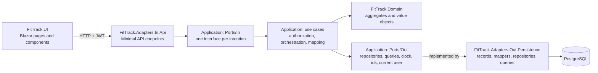
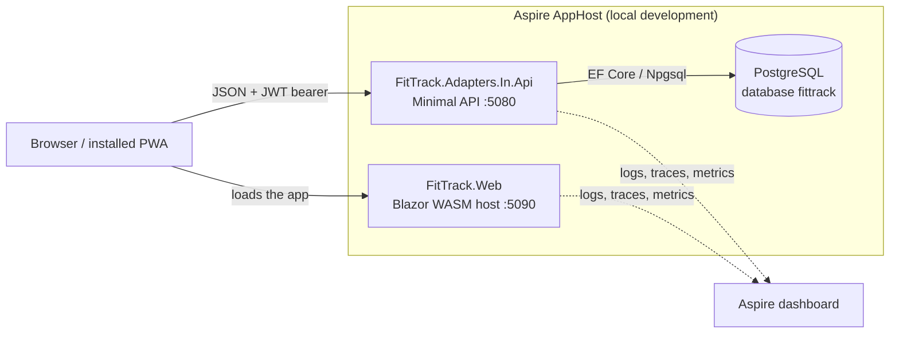
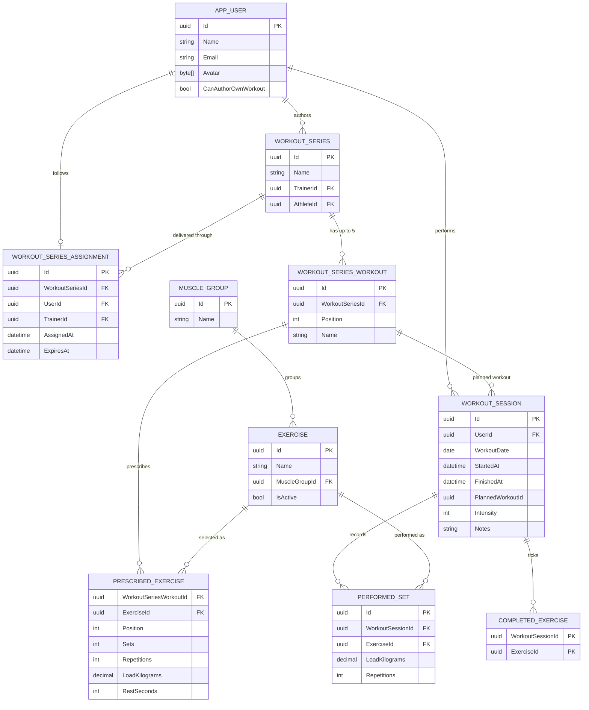
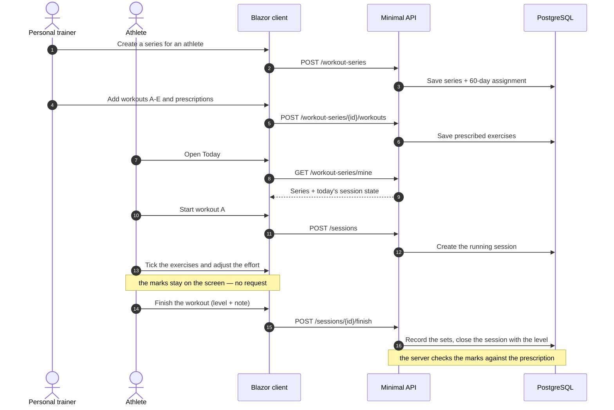
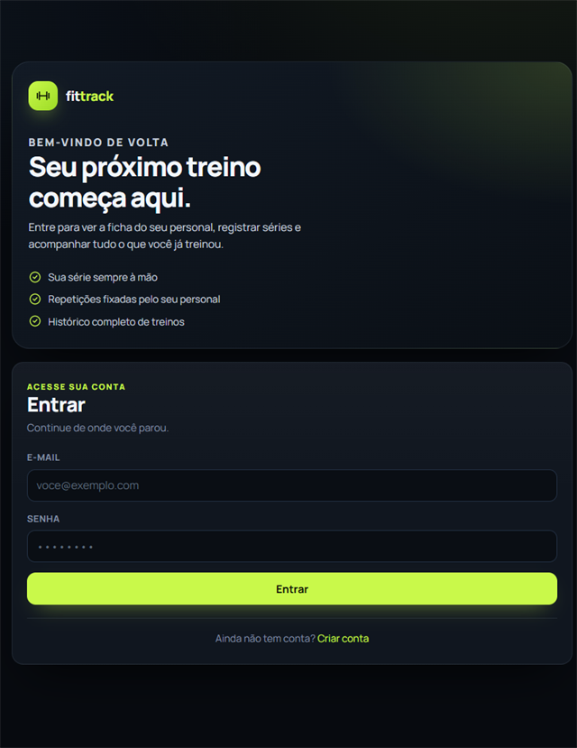
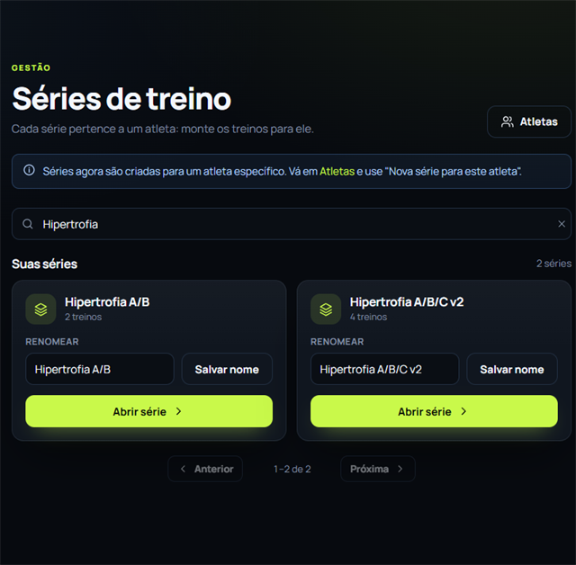
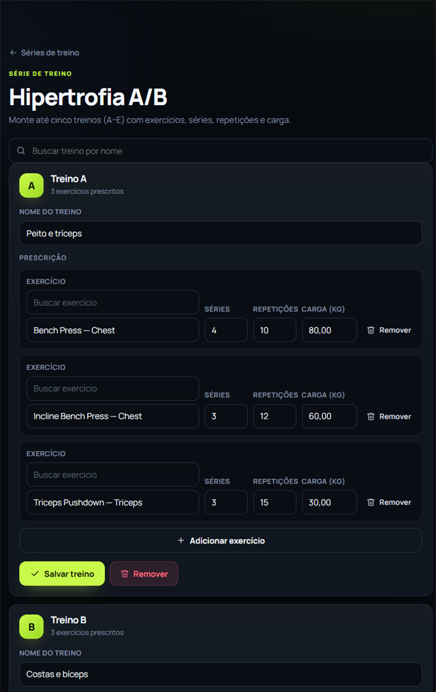
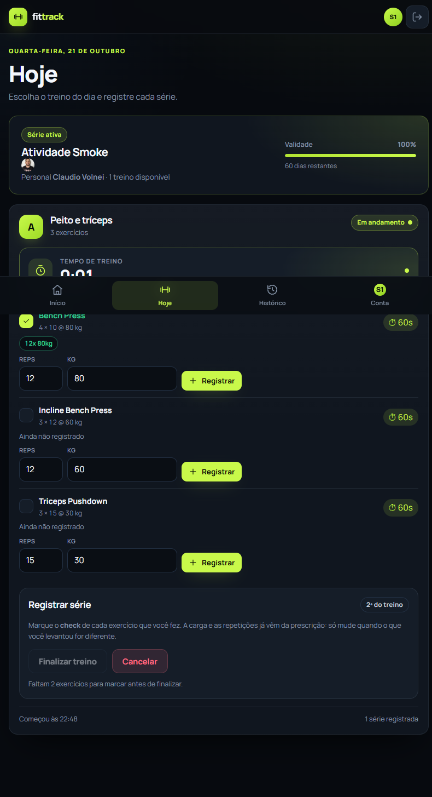
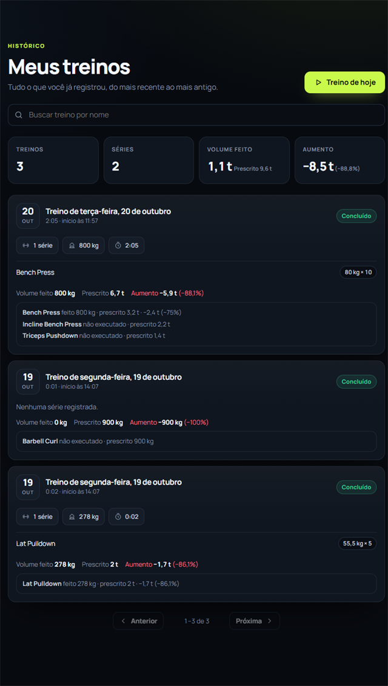

# FitTrack

Fitness tracking platform with three profiles: administrators manage accounts, personal trainers own
the muscle-group/exercise catalog and build a workout series for a specific athlete, and athletes
follow that series, start today's workout and log the sets they actually performed. A series holds up
to five workouts labelled A–E; each workout prescribes exercises, sets, repetitions, load and a rest
time per exercise (60 seconds by default, editable), and the
delivery term is 60 days counted from its creation. One workout per day: the athlete trains once,
and the workout closes only with every prescribed exercise ticked — the tick lives on the screen and
the whole workout travels in one request when the athlete finishes it, together with the level they
gave the session and what they wrote about it. The web client UI is in Brazilian Portuguese.

## Stack

- .NET 10
- .NET Aspire 13 for local orchestration (PostgreSQL, API, web client)
- ASP.NET Core Minimal APIs with OpenAPI, Scalar and JWT bearer authentication
- ASP.NET Core Identity backed by EF Core stores for accounts and roles
- EF Core 10 with the Npgsql provider
- Blazor WebAssembly for the client, shipped as an installable PWA
- xUnit for unit and integration tests

## Architecture

Hexagonal (ports and adapters) with tactical Domain-Driven Design. The dependency rule always
points inward: adapters depend on Application, Application depends on Domain, and Domain depends on
nothing.



### Runtime view



### Projects

| Project | Role |
| --- | --- |
| `FitTrack.Domain` | Entities, value objects and invariants across `WorkoutCatalog`, `WorkoutPlanning`, `WorkoutExecution` and `Identity` |
| `FitTrack.Application` | Use cases (one class per actor intention), inbound ports, outbound ports, commands, DTOs and mapping |
| `FitTrack.Adapters.In.Api` | Inbound adapter: endpoints, request contracts, JWT authentication, policies, CORS, development seeding and composition root |
| `FitTrack.Adapters.Out.Persistence` | Outbound adapter: `FitTrackDbContext`, records, mappers, repositories, query services and migrations |
| `FitTrack.UI` | Blazor pages, components, typed API client, token storage and authentication state |
| `FitTrack.UITests` | bUnit screen tests over the Blazor components, with a fake API |
| `FitTrack.Web` | Blazor WebAssembly host and PWA manifest/service worker |
| `FitTrack.ServiceDefaults` | Aspire observability and resilience defaults shared by the services |
| `FitTrack.AppHost` | Aspire orchestration of PostgreSQL, the API and the web client |

### Bounded contexts

| Context | Aggregates | Responsibility |
| --- | --- | --- |
| `WorkoutCatalog` | `MuscleGroup`, `Exercise` | The catalog a trainer reads when prescribing exercises |
| `WorkoutPlanning` | `WorkoutSeries`, `WorkoutSeriesAssignment` | Series for one athlete, workouts A–E, prescriptions and the 60-day term |
| `WorkoutExecution` | `WorkoutSession`, `PerformedSet` | A workout started from a prescribed workout, its running clock, sets and finish/cancel state |
| `Identity` | `UserId`, `Roles`, `TrainerAthleteAssignment` plus the Identity `AppUser` | Accounts, roles, the athlete↔trainer roster link, the release to build one's own plan and the current-user boundary |

### Domain model



The session keeps the chosen workout by id without a foreign key: editing or removing a workout later
must never rewrite what an athlete already performed.

### Main flow



### HTTP surface

| Area | Endpoints | Access |
| --- | --- | --- |
| Authentication | `POST /auth/register`, `POST /auth/login`, `POST /auth/change-password` | Register/login anonymous; password change authenticated |
| Account | `GET/POST/DELETE /me/avatar`, `GET /users/{userId}/avatar` | Authenticated |
| Administration | `GET/POST /admin/users`, `POST/DELETE /admin/users/{userId}/roles`, `POST /admin/users/{userId}/password`, `POST/DELETE /admin/users/{userId}/self-authoring` | `Admin`; `self-authoring` grants (or takes back) the release that lets an athlete build their own training plan |
| Administration | `GET/POST /admin/users?role=`, `POST/DELETE /admin/users/{userId}/roles`, `POST /admin/users/{userId}/password` | `Admin`; the `role` filter is a plain role name, e.g. `PersonalTrainer` |
| Catalog | `GET /exercises`, `POST /exercises`, `PUT/DELETE /exercises/{id}`, `GET/POST /muscle-groups`, `PUT/DELETE /muscle-groups/{id}` | Reads authenticated; writes `PersonalTrainer`. Deletion is refused (409) while the member is still referenced |
| Roster & planning | `GET /athletes?candidates=`, `GET /athletes/{userId}/workouts`, `POST/DELETE /athletes/{userId}/trainer`, `GET/POST /workout-series`, `GET/PUT /workout-series/{seriesId}`, `POST/GET /workout-series/{seriesId}/athletes`, `POST /workout-series/{seriesId}/workouts`, `PUT/DELETE /workout-series/{seriesId}/workouts/{workoutId}` | `PersonalTrainer` **or** `Admin`, and an athlete the administrator released. The personal trainer reads only their own athletes' list and history and prescribes only to them (creating a series accepts several athletes of their roster, one assignment each; `POST .../athletes` assigns an **existing** series of their own to athletes of their roster, and `GET .../athletes` lists the series' followers — both author-only, no admin bypass); the admin reads and acts on every roster. `GET /athletes?candidates=true` lists athletes linked to nobody; `POST .../trainer` links (idempotent when the trainer is the same, 409 `roster.busy` otherwise), `DELETE .../trainer` unlinks |
| Series cycle | `POST /athletes/{athleteId}/series/end` | The personal trainer ends the cycle of an athlete on their own roster; an athlete released by the administrator ends their own cycle |
| Athlete series | `GET /workout-series/mine` | Authenticated (no id; always the caller's own series) |
| Execution | `GET/POST /sessions`, `POST /sessions/{id}/finish`, `DELETE /sessions/{id}` | Authenticated, own sessions only |

`POST /sessions/{id}/finish` closes the workout in one request: `{"intensity": "moderado", "notes":
"…", "exercises": [{"exerciseId": "…", "repetitions": 10, "loadKilograms": 40}]}`. The intensity is
one of `leve`, `medio`, `moderado`, `intenso` or `muitoIntenso`; the note is optional (500
characters); the exercises cover the whole prescription (409 `session.finish.exercises.pending`
otherwise) and nothing outside it (400 `session.set.exercise.not_prescribed`). The number of sets
comes from the prescription — the athlete adjusts the repetitions and the load, not the sheet.

Collection reads accept `search`, `page` and `pageSize` (`pageSize` 1–100). Without `page` or `pageSize`
they keep returning the plain array; with either one they return the paginated envelope. In
Development the OpenAPI document is served at `/openapi/v1.json` and the Scalar UI at `/scalar`.

## Current state

- JWT authentication with the `Admin`, `PersonalTrainer` and `User` (athlete) roles enforced by endpoint policies and by the use cases.
- Public registration, password change, avatar upload/removal and admin account management (create account, grant/revoke roles, reset password).
- Muscle-group and exercise catalog with an active flag; trainers write it, any signed-in user reads it. Deletion is guarded: a member still referenced by a prescription, a performed set or a child exercise is refused with 409.
- One series per athlete, with up to five workouts A–E, each with sets, repetitions, load and a rest time per prescribed exercise (default 60 s, editable, 0 disables the timer); creating the series also starts its 60-day term.
- The personal trainer ends a cycle early with "Vencer série atual": the athlete is left without a series until the next one is created, and the new series can start from the sheet of the cycle that just ended (the previous series and everything already trained stay where they are).
- Each athlete answers to one personal trainer. The roster link gates what a trainer sees and does: only their own athletes on `/Athletes`, only their history, and series can only be prescribed to (or reassigned through) a linked athlete. `Admin` sees and acts on every roster. The same screen doubles as the link screen — a trainer searches athletes linked to nobody to add them, the admin picks the trainer from a searchable combobox (every personal trainer, found by name or e-mail), and either can unlink (the series stays; the next trainer replaces it).
- The administrator can also release an athlete to build their own training plan, without a personal trainer (`POST/DELETE /admin/users/{userId}/self-authoring`, on the account card in `/admin/users`). With the release, the athlete creates and composes a series of their own — "Meu plano" — reusing the sheet of the cycle they are in; the series becomes their active plan and the banner says "Montado por você". Without it, the athlete needs a personal trainer and the API refuses the creation with 403. The release lives in the account and not in the token, so a revocation takes effect at once.
- Today's workout starts idempotently, runs a server-based timer and takes only prescribed exercises. One workout per day: a second workout of the series is refused (409) while the day already has one — running or finished. The athlete ticks each exercise on the screen — the mark costs no request — and the prescription stays as the value: a click opens the repetitions and the load for the day the real effort was different. The workout closes in a single request that carries the marks, the level the athlete gave the session (leve, médio, moderado, intenso, muito intenso) and what they wrote about it; the server checks the marks against the prescription and only then closes the session. The athlete opens a countdown modal per exercise from the prescribed rest time, pauses/resumes it and gets an alert when it reaches zero. The prescribed exercises of each workout start collapsed and open on demand (`SeriesExerciseList`), and the same collapsible rules the prescription editor inside a series (`/series/{id}`).
- Finishing closes the session; cancelling removes it. History shows duration, set count, volume, the level of the session and the "about the workout" line (always present: when the athlete wrote nothing the card says "não informado"), with a per-exercise comparison of the athlete's average set load against the prescribed load (the increase is the sum of those load differences, never multiplied by sets or repetitions); consecutive sets performed with the same exercise, repetitions and load collapse into one header (`4 × 20 · 20 kg`) that expands back to the individual rows; a session taken from a series also reports which one (`workoutSeriesName` in the session listing, null for sessions with no such reference).
- Collection screens support search and pagination; the API keeps the original plain-array response unless paging parameters are sent.
- Errors arrive in one place: every server failure shows as a toast in the corner of the screen, and the screen is blocked by an overlay while a request is on its way to the server.
- Responsive pt-BR Blazor UI with role-aware navigation, installable PWA assets and an offline app shell. The mobile tab bar caps at four tabs, and one navigation registry (`FitTrack.UI/Layout/NavOptions.cs`) drives both the desktop sidebar and the mobile bottom tabs, ordered by priority: athlete, trainer, admin; anything beyond the cap moves to a "Mais" sheet. The top bar and the content offset honor `env(safe-area-inset-top)`, so the iOS status bar (clock, battery) on notch devices never overlaps the bar.

### Screens

Captured from the local Aspire AppHost with the development seed.

| Sign-in | Trainer: series list |
| --- | --- |
|  |  |
| Email/password sign-in; the session token is kept in the browser. | Every series belongs to an athlete; search filters the list before opening the editor. |

| Trainer: workout editor | Athlete: today's workout |
| --- | --- |
|  |  |
| Workouts A–E with the prescription editor (exercise, sets, repetitions, load and rest time). | Workout A in progress: running timer, a tick per exercise, the repetitions and the load of each set, and a rest countdown per exercise. |

| Athlete: history |
| --- |
|  |
| Finished sessions, newest first, with duration, set count, executed volume and the per-exercise load comparison against the prescription. |

## Getting started

Prerequisites: the .NET 10 SDK and a container runtime (Docker Desktop or Podman) so Aspire can start
PostgreSQL.

```bash
dotnet run --project src/FitTrack.AppHost
```

- Web client: <http://localhost:5090>
- API: <http://localhost:5080>
- API documentation (Development): `/openapi/v1.json` and Scalar at <http://localhost:5080/scalar>

On startup in Development the API applies the EF Core migrations (which also backfill the roster
links from existing series assignments) and seeds a starter catalog plus four accounts, so the flow
can be exercised without manual setup:

| Role | Email | Password |
| --- | --- | --- |
| Admin | `admin@fittrack.local` | `Admin123$` |
| Personal trainer | `trainer@fittrack.local` | `Trainer123$` |
| Athlete | `athlete@fittrack.local` | `Athlete123$` |
| Athlete (no trainer) | `athlete2@fittrack.local` | `Athlete123$` |

The seed links the first athlete to the personal trainer but does not create a series. Sign in as the
trainer, open **Atletas**, create a series for the athlete and add workouts A–E; then sign in as the
athlete to start today's workout. The second athlete is on nobody's roster and shows up in the trainers'
link search (candidatos).

The signing key and database credentials committed in `appsettings.Development.json` are
development-only. Real environments must supply `Jwt:SigningKey` and the connection string as
configuration or secrets. Aspire stores PostgreSQL data in the `fittrack-postgres-data` volume, so the
database survives an AppHost restart.

## Deploy

Production runs the API as a Docker image on Render's free plan, PostgreSQL on Neon's free plan and
the Blazor client as static assets on Cloudflare Workers. `render.yaml` is the Render Blueprint; the
step-by-step cut-over, free-tier limits and rollback are in
[docs/deploy/render-neon.md](docs/deploy/render-neon.md).

## Tests

```bash
dotnet test
```

`FitTrack.Unit` covers domain invariants and application use cases with in-memory fakes and needs no
infrastructure. `FitTrack.Integration` boots the real API through `WebApplicationFactory`; the tests
that need a database are skipped unless `FITTRACK_TEST_DB` holds a PostgreSQL connection string. Both
suites compile the shared refusal table from `tests/FitTrack.TestCases`, so the fake and the real
adapter cannot drift apart. `FitTrack.UITests` drives the Blazor screens with bUnit over a fake API,
so the marks that stay on the screen and the requests that never leave it are proved there.
