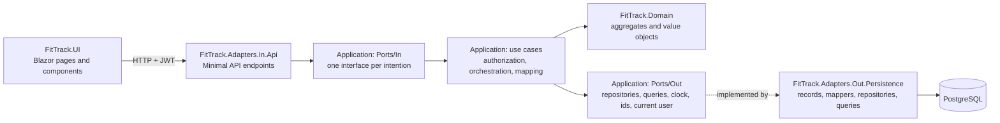
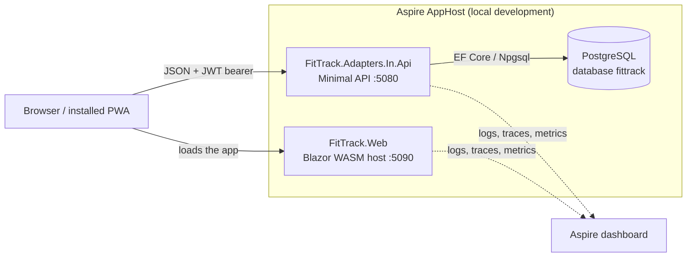
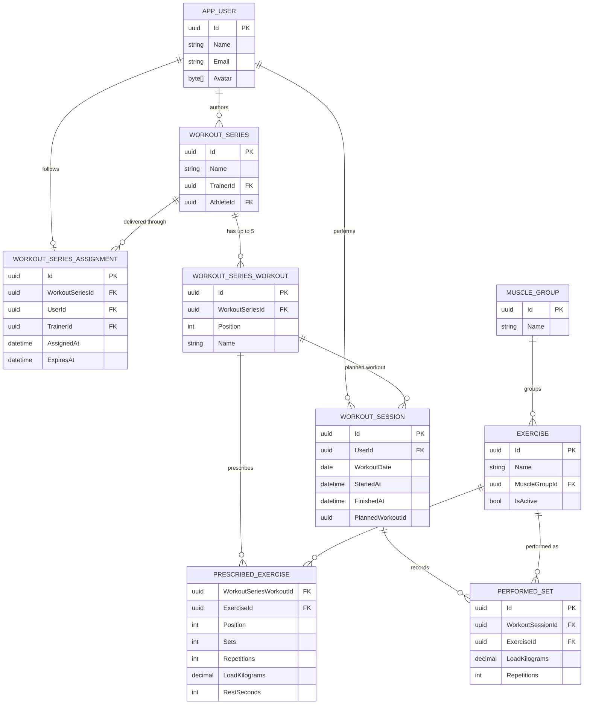
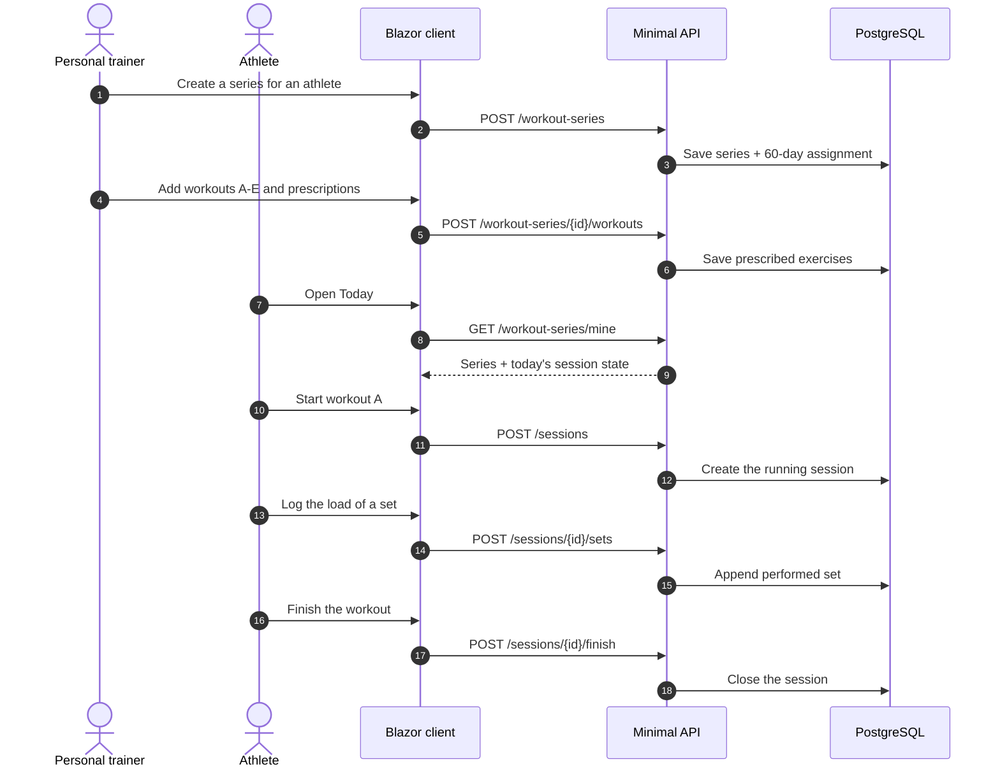

# FitTrack

Fitness tracking platform with three profiles: administrators manage accounts, personal trainers own
the muscle-group/exercise catalog and build a workout series for a specific athlete, and athletes
follow that series, start today's workout and log the sets they actually performed. A series holds up
to five workouts labelled A–E; each workout prescribes exercises, sets, repetitions, load and a rest
time per exercise (60 seconds by default, editable), and the
delivery term is 60 days counted from its creation. The web client UI is in Brazilian Portuguese.

## Stack

- .NET 10
- .NET Aspire 13 for local orchestration (PostgreSQL, API, web client)
- ASP.NET Core Minimal APIs with OpenAPI, Scalar and JWT bearer authentication
- ASP.NET Core Identity backed by EF Core stores for accounts and roles
- EF Core 10 with the Npgsql provider
- Blazor WebAssembly for the client, shipped as an installable PWA
- xUnit for unit and integration tests

## Architecture

Hexagonal (ports and adapters) with tactical Domain-Driven Design. The dependency rule always
points inward: adapters depend on Application, Application depends on Domain, and Domain depends on
nothing.



### Runtime view



### Projects

| Project | Role |
| --- | --- |
| `FitTrack.Domain` | Entities, value objects and invariants across `WorkoutCatalog`, `WorkoutPlanning`, `WorkoutExecution` and `Identity` |
| `FitTrack.Application` | Use cases (one class per actor intention), inbound ports, outbound ports, commands, DTOs and mapping |
| `FitTrack.Adapters.In.Api` | Inbound adapter: endpoints, request contracts, JWT authentication, policies, CORS, development seeding and composition root |
| `FitTrack.Adapters.Out.Persistence` | Outbound adapter: `FitTrackDbContext`, records, mappers, repositories, query services and migrations |
| `FitTrack.UI` | Blazor pages, components, typed API client, token storage and authentication state |
| `FitTrack.Web` | Blazor WebAssembly host and PWA manifest/service worker |
| `FitTrack.ServiceDefaults` | Aspire observability and resilience defaults shared by the services |
| `FitTrack.AppHost` | Aspire orchestration of PostgreSQL, the API and the web client |

### Bounded contexts

| Context | Aggregates | Responsibility |
| --- | --- | --- |
| `WorkoutCatalog` | `MuscleGroup`, `Exercise` | The catalog a trainer reads when prescribing exercises |
| `WorkoutPlanning` | `WorkoutSeries`, `WorkoutSeriesAssignment` | Series for one athlete, workouts A–E, prescriptions and the 60-day term |
| `WorkoutExecution` | `WorkoutSession`, `PerformedSet` | A workout started from a prescribed workout, its running clock, sets and finish/cancel state |
| `Identity` | `UserId`, `Roles` plus the Identity `AppUser` | Accounts, roles and the current-user boundary |

### Domain model



The session keeps the chosen workout by id without a foreign key: editing or removing a workout later
must never rewrite what an athlete already performed.

### Main flow



### HTTP surface

| Area | Endpoints | Access |
| --- | --- | --- |
| Authentication | `POST /auth/register`, `POST /auth/login`, `POST /auth/change-password` | Register/login anonymous; password change authenticated |
| Account | `GET/POST/DELETE /me/avatar`, `GET /users/{userId}/avatar` | Authenticated |
| Administration | `GET/POST /admin/users`, `POST/DELETE /admin/users/{userId}/roles`, `POST /admin/users/{userId}/password` | `Admin` |
| Catalog | `GET /exercises`, `POST /exercises`, `PUT/DELETE /exercises/{id}`, `GET/POST /muscle-groups`, `PUT/DELETE /muscle-groups/{id}` | Reads authenticated; writes `PersonalTrainer`. Deletion is refused (409) while the member is still referenced |
| Planning | `GET /athletes`, `GET /athletes/{userId}/workouts`, `GET/POST /workout-series`, `GET/PUT /workout-series/{seriesId}`, `POST /workout-series/{seriesId}/workouts`, `PUT/DELETE /workout-series/{seriesId}/workouts/{workoutId}` | `PersonalTrainer` |
| Athlete series | `GET /workout-series/mine` | Authenticated (no id; always the caller's own series) |
| Execution | `GET/POST /sessions`, `POST /sessions/{id}/sets`, `POST /sessions/{id}/finish`, `DELETE /sessions/{id}` | Authenticated, own sessions only |

Collection reads accept `search`, `page` and `pageSize` (`pageSize` 1–100). Without `page` or `pageSize`
they keep returning the plain array; with either one they return the paginated envelope. In
Development the OpenAPI document is served at `/openapi/v1.json` and the Scalar UI at `/scalar`.

## Current state

- JWT authentication with the `Admin`, `PersonalTrainer` and `User` (athlete) roles enforced by endpoint policies and by the use cases.
- Public registration, password change, avatar upload/removal and admin account management (create account, grant/revoke roles, reset password).
- Muscle-group and exercise catalog with an active flag; trainers write it, any signed-in user reads it. Deletion is guarded: a member still referenced by a prescription, a performed set or a child exercise is refused with 409.
- One series per athlete, with up to five workouts A–E, each with sets, repetitions, load and a rest time per prescribed exercise (default 60 s, editable, 0 disables the timer); creating the series also starts its 60-day term.
- Today's workout starts idempotently, runs a server-based timer, accepts only prescribed exercises and takes repetitions from the prescription. The athlete opens a countdown modal per exercise from the prescribed rest time, pauses/resumes it and gets an alert when it reaches zero.
- Finishing closes the session; cancelling removes it. History shows duration, set count, volume and a per-exercise comparison with the current prescription.
- Collection screens support search and pagination; the API keeps the original plain-array response unless paging parameters are sent.
- Responsive pt-BR Blazor UI with role-aware navigation, installable PWA assets and an offline app shell. The mobile tab bar caps at four tabs, and one navigation registry (`FitTrack.UI/Layout/NavOptions.cs`) drives both the desktop sidebar and the mobile bottom tabs, ordered by priority: athlete, trainer, admin; anything beyond the cap moves to a "Mais" sheet.

### Screens

Captured from the local Aspire AppHost with the development seed.

| Sign-in | Trainer: series list |
| --- | --- |
|  |  |
| Email/password sign-in; the session token is kept in the browser. | Every series belongs to an athlete; search filters the list before opening the editor. |

| Trainer: workout editor | Athlete: today's workout |
| --- | --- |
|  |  |
| Workouts A–E with the prescription editor (exercise, sets, repetitions, load and rest time). | Workout A in progress: running timer, prescribed loads and one log button per exercise, with a rest countdown per exercise. |

| Athlete: history |
| --- |
|  |
| Finished sessions, newest first, with duration, set count, executed volume and the comparison against the prescription. |

## Getting started

Prerequisites: the .NET 10 SDK and a container runtime (Docker Desktop or Podman) so Aspire can start
PostgreSQL.

```bash
dotnet run --project src/FitTrack.AppHost
```

- Web client: <http://localhost:5090>
- API: <http://localhost:5080>
- API documentation (Development): `/openapi/v1.json` and Scalar at <http://localhost:5080/scalar>

On startup in Development the API applies the EF Core migrations and seeds a starter catalog plus
three accounts, so the flow can be exercised without manual setup:

| Role | Email | Password |
| --- | --- | --- |
| Admin | `admin@fittrack.local` | `Admin123$` |
| Personal trainer | `trainer@fittrack.local` | `Trainer123$` |
| Athlete | `athlete@fittrack.local` | `Athlete123$` |

The seed does not create a series. Sign in as the trainer, open **Atletas**, create a series for the
athlete and add workouts A–E; then sign in as the athlete to start today's workout.

The signing key and database credentials committed in `appsettings.Development.json` are
development-only. Real environments must supply `Jwt:SigningKey` and the connection string as
configuration or secrets. Aspire stores PostgreSQL data in the `fittrack-postgres-data` volume, so the
database survives an AppHost restart.

## Tests

```bash
dotnet test
```

`FitTrack.Unit` covers domain invariants and application use cases with in-memory fakes and needs no
infrastructure. `FitTrack.Integration` boots the real API through `WebApplicationFactory`; the tests
that need a database are skipped unless `FITTRACK_TEST_DB` holds a PostgreSQL connection string. Both
suites compile the shared refusal table from `tests/FitTrack.TestCases`, so the fake and the real
adapter cannot drift apart.
